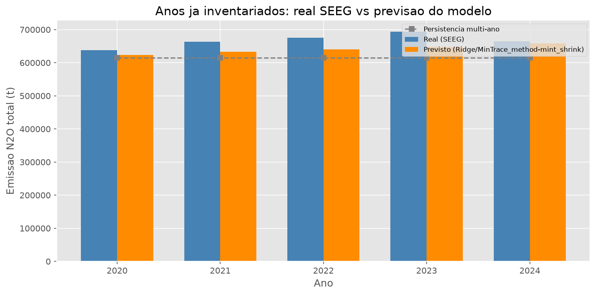
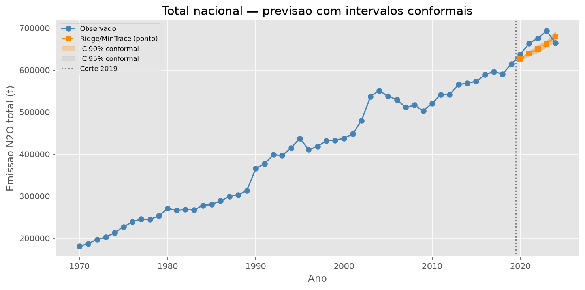
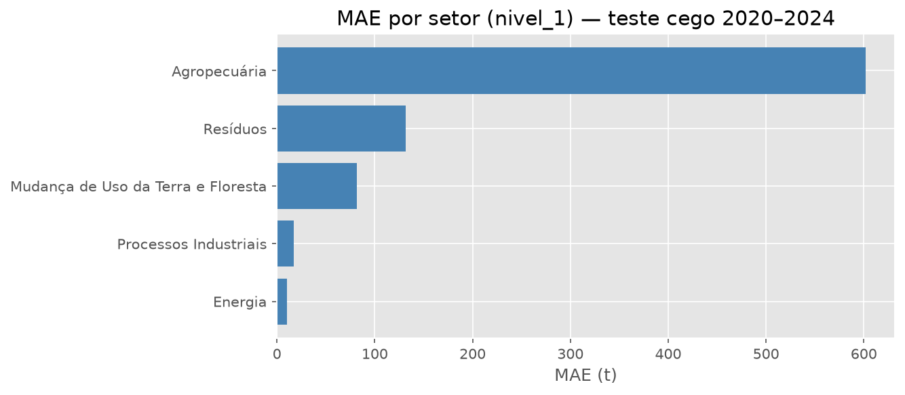
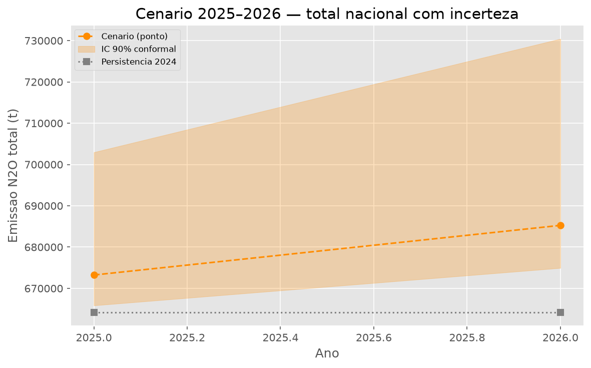
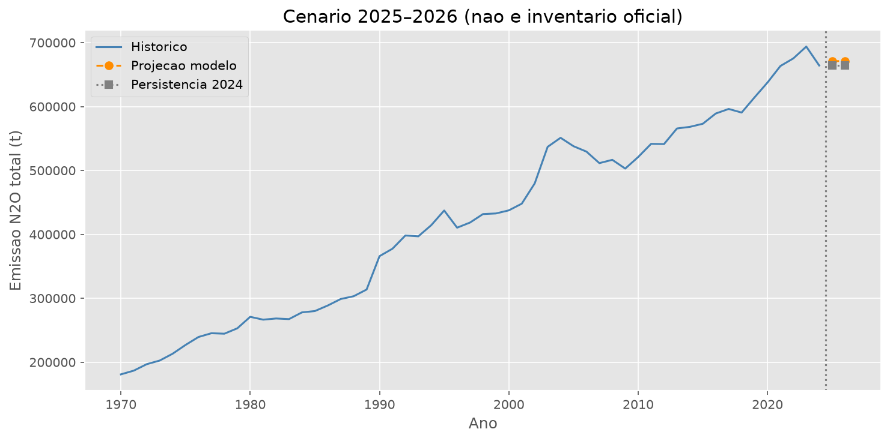
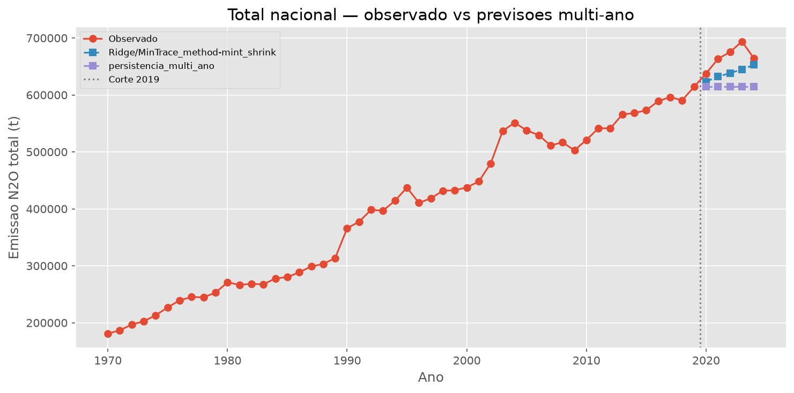

# Apresentação — Previsão N2O (TCC)

> Export gerado automaticamente. Abra no Typora / VS Code / exporte para PDF.

---

## Slide 1 — Pergunta

- Com dados SEEG até **2019**, prever **2020–2024** sem ver anos intermediários
- Referência: persistência multi-ano (copiar 2019)
- Protocolo anti-vazamento: previsão direta h=5 + reconciliação MinT

---

## Slide 2 — Resultado principal

- Modelo campeão: **Ridge/MinTrace_method-mint_shrink**
- MAE teste: **88.03 t**
- Δ vs persistência: **14.71 t** (ganho)
- Barreira Ridge/MinTrace(ols): **83.85 t**

---

## Slide 3 — Platô MAE (experimentos negativos)

- LGBM tunado, NHITS, ensemble Ridge+LGBM/NHITS, DTW por cluster
- Nenhum superou Ridge de forma consistente
- Próximo passo: **incerteza** (Conformal Prediction), não novo tuning pontual

Ver `resultados/tabela_experimentos.csv`

---

## Slide 4 — Incerteza (Conformal)

- Cobertura folha 90%: **91.4%** (próximo do nominal)
- Intervalos simétricos sobre Ridge/MinTrace(ols)
- Nacional: poucos pontos no teste — IC agregado limitado

---

## Slide 5 — MAE por setor

- Erro heterogêneo entre setores SEEG (nível 1)
- Agropecuária concentra maior parte da emissão

---

## Slide 6 — Cenário 2025–2026

- Ponto + faixa 90% conformal (total nacional)
- **Cenário de curto prazo — não substitui inventário SEEG oficial**

---

## Slide 7 — Pipeline e inferência

- MinT clássico + clip: núcleo ~**1,2 s**
- UI: Nest + Next lendo `resultados/`
- Repo: https://github.com/ThiagoBelagamba/n2o-forecast

---

## Slide 8 — Conclusão

1. Ridge reconciliado vence persistência multi-ano no teste cego
2. Erro pontual estabilizou (platô MAE)
3. Conformal entrega intervalos calibrados nas folhas
4. Entrega operacional: cenário 2025–2026 com incerteza
